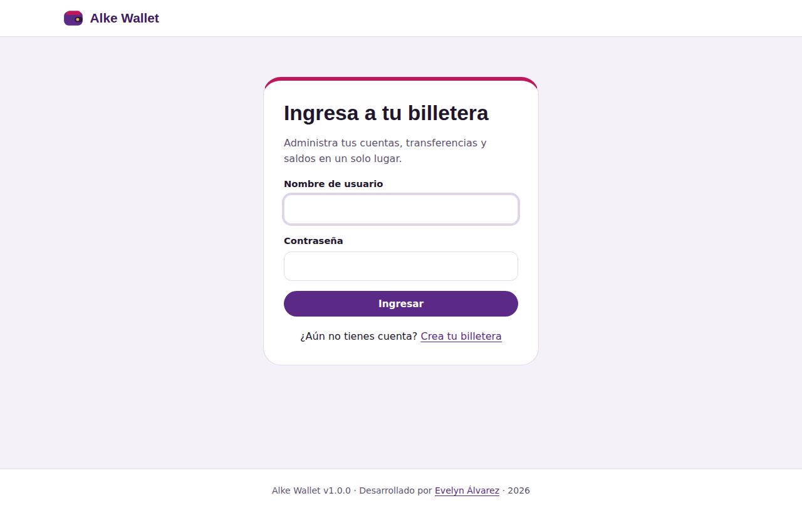
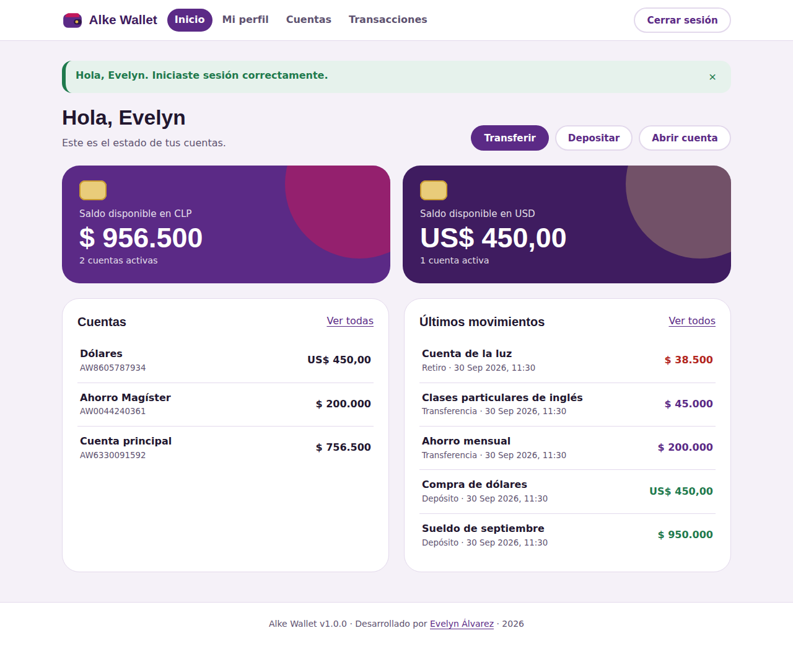
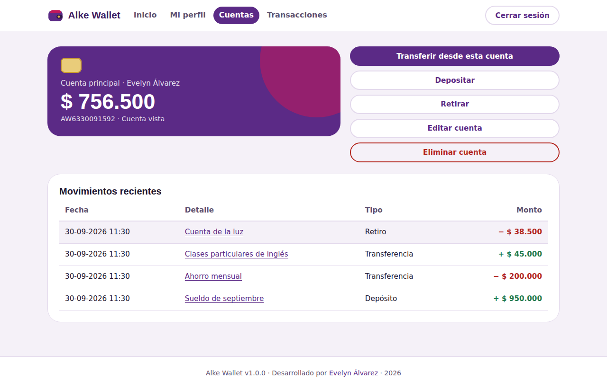
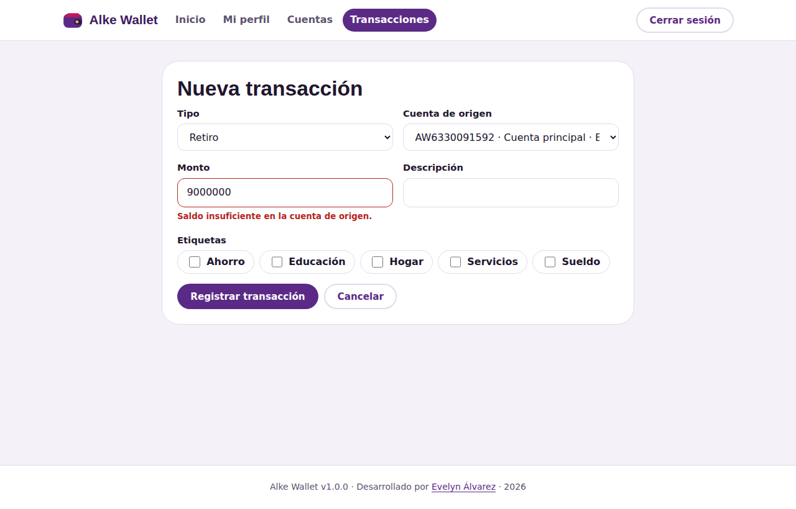
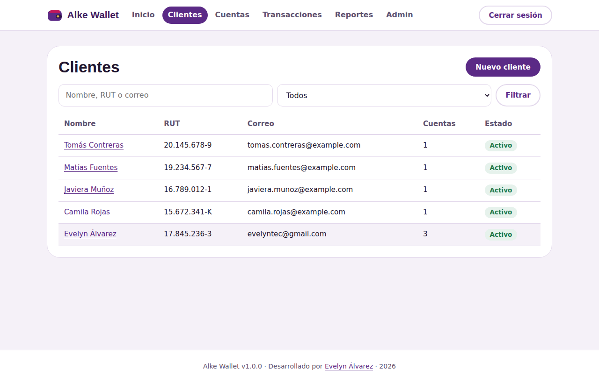
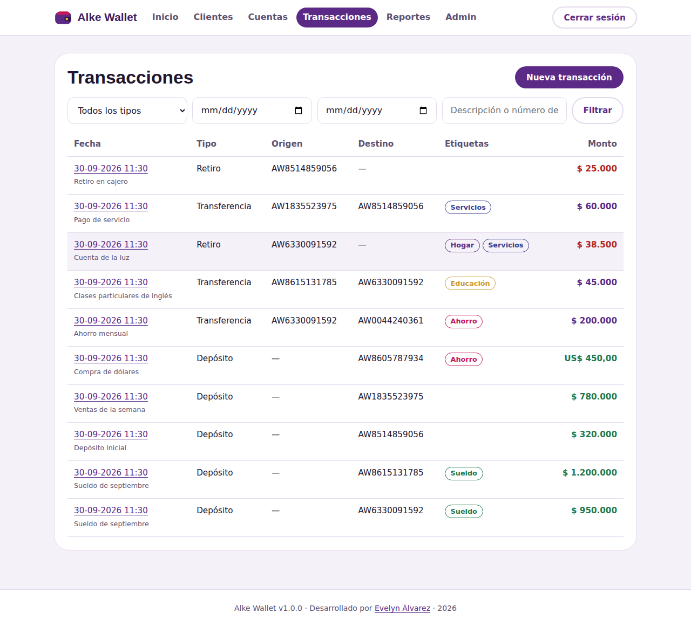
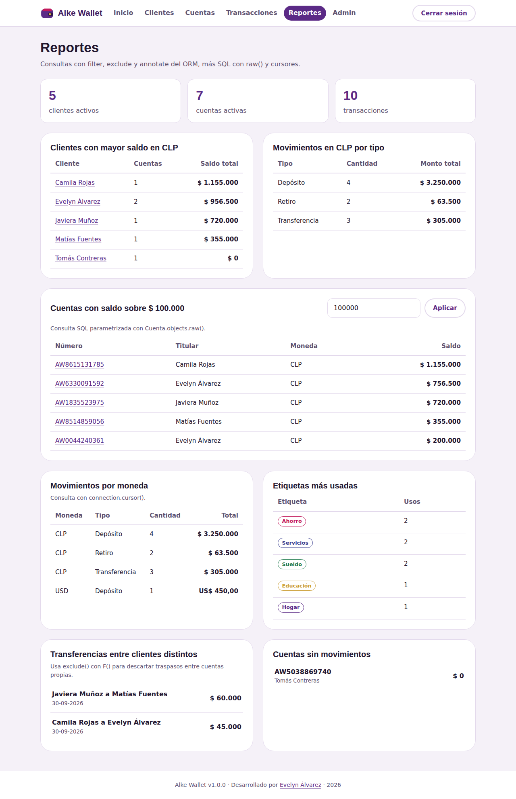
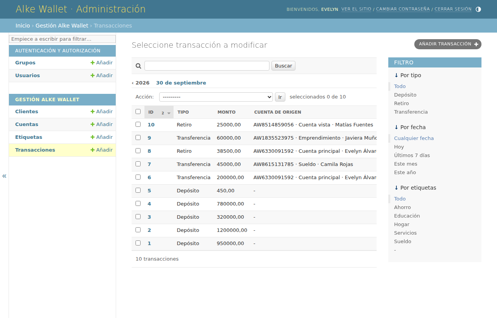
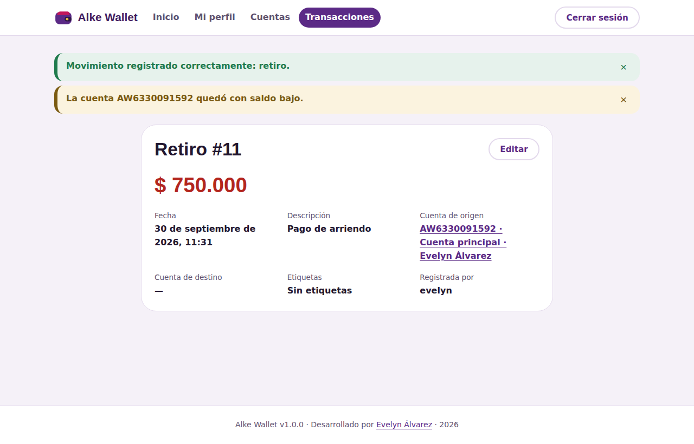

# Alke Wallet

Billetera digital desarrollada con Django para Alke Financial. Permite registrar clientes, abrir cuentas en pesos o dólares, hacer depósitos, retiros y transferencias, consultar saldos y revisar reportes. Proyecto de evaluación del Módulo 7, Desarrollo Web con Django (Alkemy).

| | |
|---|---|
| **Autora** | Evelyn Alejandra Álvarez Vásquez |
| **GitHub** | [@evelyntec](https://github.com/evelyntec) |
| **Sitio** | [profesoraevelyn.com](https://profesoraevelyn.com/) |
| **Fecha de entrega** | 23 de septiembre de 2026 |
| **Versión** | 1.0.0 |

## Tecnologías

Python 3.12, Django 4.2 LTS, SQLite para desarrollo, PostgreSQL para producción (adaptador `psycopg2-binary`), `python-dotenv` para variables de entorno, `coverage` para medir las pruebas y Visual Studio Code como editor. Todas las herramientas son gratuitas.

## Arquitectura

```text
alke-wallet/
├── manage.py
├── requirements.txt
├── .env.example
├── .gitignore
├── README.md
├── INFORME_PRUEBAS.md
├── alke_wallet/                 configuración del proyecto
│   ├── settings.py              base de datos, apps, estáticos, login
│   ├── urls.py                  rutas raíz: admin, auth y gestion
│   ├── wsgi.py
│   └── asgi.py
├── gestion/                     aplicación principal
│   ├── models.py                Cliente, Cuenta, Transaccion, Etiqueta
│   ├── validators.py            RUT chileno, teléfono y color
│   ├── forms.py                 formularios con validación
│   ├── views.py                 vistas basadas en clases (CRUD)
│   ├── urls.py                  rutas dinámicas con <int:pk>
│   ├── consultas.py             filter, exclude, annotate, raw() y cursor
│   ├── admin.py                 registro de modelos en /admin
│   ├── context_processors.py
│   ├── templatetags/formatos.py filtro para mostrar montos en CLP y USD
│   ├── management/commands/cargar_demo.py
│   ├── migrations/0001_initial.py
│   └── tests.py                 46 pruebas unitarias y de integración
├── templates/
│   ├── base.html
│   ├── registration/login.html
│   ├── registration/registro.html
│   └── gestion/*.html
├── static/
│   ├── css/estilos.css
│   ├── js/transaccion.js
│   ├── js/avisos.js
│   └── img/logo.svg
└── docs/capturas/               capturas de pantalla para la entrega
```

La aplicación sigue el patrón Modelo, Vista, Plantilla de Django. Los modelos concentran las reglas del negocio (validaciones, registrar y anular transacciones), las vistas se encargan de permisos y flujo, y las plantillas solo muestran datos.

## Modelo de datos

| Modelo | Campos principales | Relaciones |
|---|---|---|
| `Cliente` | rut (único, validado), nombre, apellido, email (único), teléfono, activo | **Uno a Uno** con `User` de `django.contrib.auth` |
| `Cuenta` | número (generado, único), alias, tipo, moneda, saldo, activa | **Muchos a Uno** con `Cliente` |
| `Transaccion` | tipo, monto, descripción, fecha, registrada_por | **Muchos a Uno** con `Cuenta` (origen y destino) y **Muchos a Muchos** con `Etiqueta` |
| `Etiqueta` | nombre (único), color | **Muchos a Muchos** con `Transaccion` |

Validaciones aplicadas: dígito verificador del RUT, formato de celular chileno, correo único, saldo nunca negativo (validador y `CheckConstraint` en la base de datos), monto mayor a cero, reglas por tipo de movimiento (un depósito necesita destino, un retiro necesita origen, una transferencia necesita ambas cuentas, distintas y en la misma moneda) y saldo suficiente antes de descontar.

Las transacciones actualizan los saldos dentro de `transaction.atomic()` usando expresiones `F()` con condición de saldo, de modo que dos operaciones simultáneas no pueden dejar una cuenta en negativo. Anular una transacción revierte los saldos. `on_delete=PROTECT` impide borrar clientes con cuentas o cuentas con movimientos.

## Configuración de la base de datos

La conexión se define en `alke_wallet/settings.py` y se elige con la variable `DB_ENGINE` del archivo `.env`.

Desarrollo con SQLite (valor por defecto):

```env
DB_ENGINE=sqlite
```

Producción con PostgreSQL:

```env
DB_ENGINE=postgresql
DB_NAME=alke_wallet
DB_USER=postgres
DB_PASSWORD=tu_clave
DB_HOST=localhost
DB_PORT=5432
```

Con PostgreSQL se crea primero la base de datos (`CREATE DATABASE alke_wallet;`) y luego se ejecuta `python manage.py migrate`. El adaptador `psycopg2-binary` ya está en `requirements.txt`.

## Instalación y ejecución local

Requisitos: Python 3.12 y Git.

Windows (PowerShell):

```powershell
git clone https://github.com/evelyntec/alke-wallet.git
cd alke-wallet
python -m venv venv
venv\Scripts\Activate.ps1
pip install -r requirements.txt
copy .env.example .env
python manage.py migrate
python manage.py createsuperuser
python manage.py cargar_demo
python manage.py runserver
```

Linux o macOS:

```bash
git clone https://github.com/evelyntec/alke-wallet.git
cd alke-wallet
python3 -m venv venv
source venv/bin/activate
pip install -r requirements.txt
cp .env.example .env
python manage.py migrate
python manage.py createsuperuser
python manage.py cargar_demo
python manage.py runserver
```

Luego se abre `http://127.0.0.1:8000/`.

## Usuarios de prueba

| Usuario | Contraseña | Rol |
|---|---|---|
| El que se cree con `createsuperuser` (sugerido: `evelyn.admin`) | La que se defina | Administración completa, reportes y `/admin` |
| `evelyn` | `AlkeWallet2026!` | Cliente: solo ve sus propias cuentas y movimientos |

La contraseña del usuario de demostración se puede cambiar con `python manage.py cargar_demo --password OtraClave` antes de cargar los datos.

## Rutas principales

| Ruta | Vista | Acceso |
|---|---|---|
| `/` | Resumen de saldos y últimos movimientos | Usuarios autenticados |
| `/registro/` | Crear billetera (usuario y cliente) | Público |
| `/accounts/login/` y `/accounts/logout/` | `django.contrib.auth` | Público |
| `/clientes/`, `/clientes/nuevo/`, `/clientes/<id>/`, `/clientes/<id>/editar/`, `/clientes/<id>/eliminar/` | CRUD de clientes | Crear y eliminar: staff |
| `/cuentas/`, `/cuentas/nueva/`, `/cuentas/<id>/`, `/cuentas/<id>/editar/`, `/cuentas/<id>/eliminar/` | CRUD de cuentas | Cada cliente sobre sus cuentas |
| `/transacciones/`, `/transacciones/nueva/`, `/transacciones/<id>/`, `/transacciones/<id>/editar/`, `/transacciones/<id>/anular/` | CRUD de transacciones | Anular: staff |
| `/reportes/` | Consultas personalizadas | Staff |
| `/admin/` | `django.contrib.admin` | Staff |

Todas las vistas son basadas en clases (`ListView`, `DetailView`, `CreateView`, `UpdateView`, `DeleteView`, `TemplateView`) y todos los formularios incluyen ``.

## Consultas personalizadas

Están en `gestion/consultas.py` y se muestran en `/reportes/`.

| Función | Técnica |
|---|---|
| `ranking_clientes_por_saldo` | `filter()` + `annotate(Sum, Count)` |
| `resumen_por_tipo` | `values()` + `annotate()` agrupado |
| `transferencias_entre_clientes` | `exclude()` con `F()` |
| `cuentas_sin_movimientos` | `annotate(Count)` + `filter()` |
| `etiquetas_mas_usadas` | `annotate()` sobre relación Muchos a Muchos |
| `cuentas_con_saldo_mayor_a` | `Cuenta.objects.raw()` con parámetros |
| `movimientos_por_moneda` | `connection.cursor()` con `JOIN` y `GROUP BY` |
| `estadisticas_generales` | `connection.cursor()` con subconsultas |

Las consultas SQL usan parámetros (`%s`) y nunca concatenan datos ingresados por el usuario, lo que evita inyección SQL.

Ejemplos en la shell (`python manage.py shell`):

```python
from gestion.models import Cliente, Cuenta, Transaccion
from gestion import consultas

Cliente.objects.create(rut="12.345.678-5", nombre="Ana", apellido="García", email="ana@example.com")
Cliente.objects.filter(nombre__istartswith="A")
Cuenta.objects.exclude(activa=False).filter(saldo__gt=100000)
consultas.ranking_clientes_por_saldo()
consultas.cuentas_con_saldo_mayor_a(100000)
consultas.estadisticas_generales()
```

## Aplicaciones preinstaladas

`django.contrib.admin` administra los cuatro modelos con búsqueda, filtros, cuentas en línea dentro de cada cliente y transacciones que actualizan saldos al crearse o anularse. `django.contrib.auth` entrega login, logout, registro de usuarios y control de permisos (usuario común y staff). `django.contrib.staticfiles` sirve la hoja de estilos, el script del formulario y el logo desde `static/`. También se usan `sessions` y `contenttypes`.

### Mensajes temporales (`django.contrib.messages`)

Después de cada acción la aplicación muestra un aviso que aparece una sola vez, en la página siguiente.

| Nivel | Color | Cuándo aparece |
|---|---|---|
| `success` | Verde | Al iniciar sesión, registrarse, guardar clientes o cuentas y registrar movimientos |
| `error` | Rojo | Al intentar eliminar un cliente con cuentas, una cuenta con saldo o anular sin fondos |
| `warning` | Amarillo | Cuando una cuenta queda con saldo bajo después de un retiro o transferencia |
| `info` | Violeta | Al cerrar sesión |

Los mensajes se crean en `gestion/views.py` con `messages.success()`, `messages.error()`, `messages.warning()` y `messages.info()` antes del `redirect`, y también con `SuccessMessageMixin` en las vistas de creación y edición. `templates/base.html` los recorre con `` y usa `aviso--{{ message.tags }}` como clase CSS. Los errores se anuncian como `role="alert"` para lectores de pantalla. `static/js/avisos.js` agrega un botón para cerrarlos y oculta solos los de éxito e información a los seis segundos, mientras que errores y advertencias quedan visibles hasta que la persona los cierra.

La configuración necesaria ya está en `settings.py`: `django.contrib.messages` en `INSTALLED_APPS`, `MessageMiddleware` después de `SessionMiddleware` en `MIDDLEWARE` y el procesador de contexto `django.contrib.messages.context_processors.messages` en `TEMPLATES`.

## Pruebas

```bash
python manage.py test gestion -v 2
coverage run --source=gestion manage.py test gestion
coverage report --omit="gestion/migrations/*,gestion/tests.py"
```

Resultado: 46 pruebas aprobadas, 84 % de cobertura. El detalle está en [INFORME_PRUEBAS.md](INFORME_PRUEBAS.md).

## Control de versiones

| Rama | Contenido |
|---|---|
| `main` | Código estable |
| `feature/modelos` | Modelos, validaciones, migraciones y admin |
| `feature/crud` | Vistas, formularios, plantillas, reportes y pruebas |

## Demostración funcional

Las capturas de la aplicación en funcionamiento están en `docs/capturas/` y se generaron con los datos de `python manage.py cargar_demo`.

### Inicio de sesión (`django.contrib.auth`)



### Resumen de la billetera de una clienta

La usuaria `evelyn` solo ve sus propias cuentas: saldo total en pesos y en dólares y sus últimos movimientos. Arriba aparece el mensaje de éxito del inicio de sesión.



### Detalle de una cuenta con sus movimientos



### Validación de saldo insuficiente

Al intentar retirar más dinero del disponible, el formulario muestra el error y no modifica ningún saldo.



### CRUD de clientes (vista del administrador)



### Transacciones con filtros y etiquetas



### Reportes con consultas personalizadas

`annotate()`, `exclude()` con `F()`, `raw()` parametrizado y `connection.cursor()`.



### Sitio de administración (`django.contrib.admin`)



### Mensajes temporales después de un retiro

El retiro se registra con un mensaje de éxito y, como la cuenta quedó con poco saldo, aparece también una advertencia.



## Reflexiones

El ORM permitió escribir casi toda la lógica en Python y cambiar de SQLite a PostgreSQL sin tocar los modelos ni las vistas, solo la configuración. Las migraciones dejaron un historial versionado del esquema y aplicaron también restricciones a nivel de base de datos, que protegen los datos incluso si alguien los modifica fuera de la aplicación.

Las consultas con `annotate()` resolvieron la mayoría de los reportes sin SQL manual. `raw()` y los cursores sirvieron para consultas con `JOIN` y agregaciones más específicas, siempre con parámetros para mantener la seguridad.

Lo más delicado fue mantener los saldos consistentes: por eso las transacciones se registran dentro de una transacción atómica y con actualizaciones condicionales, y las pruebas verifican tanto los casos correctos como los rechazos.

## Autora

Evelyn Alejandra Álvarez Vásquez, profesora de Educación General Básica y estudiante de Técnico en Informática. [GitHub](https://github.com/evelyntec) · [LinkedIn](https://www.linkedin.com/in/profesoraevelyn) · [profesoraevelyn.com](https://profesoraevelyn.com/)
